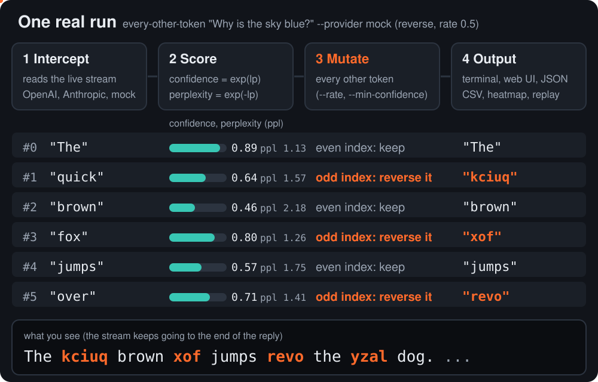
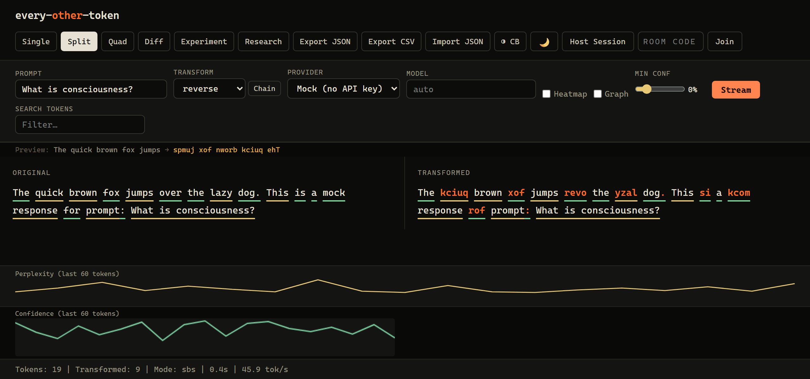

<!-- outcome-block -->
**Change an LLM's tokens while it writes. Watch its confidence move, token by token.**

Benchmarks score the final answer. This shows what happens during generation. One binary, 1,165 tests.

If it doesn't do what this README says, [open an issue](https://github.com/Mattbusel/Every-Other-Token/issues) and I'll fix it.
<!-- outcome-block -->

<p align="center">
  <a href="https://every-other-token.vercel.app/"></a>
</p>

<h1 align="center">every-other-token</h1>

<p align="center"><b>See how sure a model is about each word. Change the words while it writes.</b></p>

<p align="center">English | <a href="README.zh-CN.md">简体中文</a> | <a href="README.ja.md">日本語</a> | <a href="README.ko.md">한국어</a></p>

<p align="center">
  <a href="https://gitlab.com/mattbusel/Every-Other-Token/-/releases/permalink/latest/downloads/every-other-token-windows-x86_64.exe"><b>Download for Windows (.exe)</b></a> &nbsp;&middot;&nbsp;
  <a href="#install">Linux and macOS</a> &nbsp;&middot;&nbsp;
  <a href="https://every-other-token.vercel.app/">Project site</a> &nbsp;&middot;&nbsp;
  <a href="#documentation">Docs</a>
</p>

<p align="center">
  <a href="https://crates.io/crates/every-other-token"></a>
  <a href="https://docs.rs/every-other-token"></a>
  <a href="https://github.com/Mattbusel/Every-Other-Token/actions/workflows/ci.yml"></a>
  
</p>

**Try it in your browser, no install, no key:** [every-other-token.vercel.app/play](https://every-other-token.vercel.app/play/).

A CLI and web UI that reads the live stream from OpenAI, Anthropic, Gemini, OpenRouter or a local model (Ollama, llama.cpp, vLLM, LM Studio). It shows each token's confidence and perplexity from the logprobs. It can rewrite every other token, or any fraction, as it arrives. A mock provider runs it all with no key.

For interpretability research, red-teaming, prompt engineering, or just seeing how models pick words.

## Free browser tools

- [Token counter for GPT, Claude and Gemini](https://tensorust.com/tools/token-counter/?utm_source=github&utm_medium=readme&utm_campaign=every-other-token): what a prompt costs in tokens.
- [LLM API cost calculator](https://tensorust.com/tools/llm-api-cost/?utm_source=github&utm_medium=readme&utm_campaign=every-other-token): tokens to dollars per month, per provider.
- [LLM JSON output: one setting dropped valid JSON from 75% to 4%](https://tensorust.com/articles/llm-json-output-repetition-penalty/?utm_source=github&utm_medium=readme&utm_campaign=every-other-token): one sampling setting breaking output token by token.

## How it works



1. **Intercept.** Opens the model's SSE stream itself and sees each chunk as it arrives.
2. **Score.** Each token gets `confidence = exp(logprob)`, `perplexity = exp(-logprob)` and the top alternatives.
3. **Mutate.** Picked tokens (every other one, or only unsure ones) get a transform: reverse, uppercase, noise, delete, synonym and more.
4. **Output.** Terminal (`--tui` for full screen), web UI, or JSON lines, CSV or an HTML heatmap.

## Install

**Linux** (x86_64, Ubuntu 20.04+ / Debian 11+). One line. Installs to `~/.local/bin`:

```sh
mkdir -p ~/.local/bin && curl -fsSL https://gitlab.com/mattbusel/Every-Other-Token/-/releases/permalink/latest/downloads/every-other-token-linux-x86_64.tar.gz | tar xz --strip-components=1 -C ~/.local/bin --wildcards '*/every-other-token'
```

| Other systems | |
|---|---|
| **Windows** | [Download every-other-token-windows-x86_64.exe](https://gitlab.com/mattbusel/Every-Other-Token/-/releases/permalink/latest/downloads/every-other-token-windows-x86_64.exe) and run it. (Unsigned, so SmartScreen may ask: *More info*, then *Run anyway*.) |
| **macOS, or from source** | `cargo install --locked every-other-token` |

The Windows .exe opens the web UI. Releases with SHA-256 checksums: [Releases](https://gitlab.com/mattbusel/Every-Other-Token/-/releases).

## Examples

Real output from the mock provider (fixed reply, fixed logprobs, real pipeline). Reproducible with no key.

**1. Reverse every other token** (the default)

```console
$ every-other-token "Why is the sky blue?" --provider mock
The kciuq brown xof jumps revo the yzal dog. This si a kcom response rof prompt: Why si the yks blue?
24 tokens streamed, 12 transformed
```

**2. Rewrite only the words the model was unsure about** (confidence at or below 0.6)

```console
$ every-other-token "Why is the sky blue?" uppercase --provider mock --rate 1 --min-confidence 0.6
The quick BROWN fox JUMPS over the LAZY dog. THIS is a mock response for PROMPT: WHY IS THE SKY BLUE?
24 tokens streamed, 11 transformed
```

"brown" (0.46), "jumps" (0.57), "lazy" (0.41), "This" (0.54) and "prompt" (0.59) were below the line. The echoed prompt has no logprobs in the mock, so it uses the plain rate.

**3. Get the numbers as JSON, one line per token**

```console
$ every-other-token "Why is the sky blue?" uppercase --provider mock --json-stream
{"text":"The","original":"The","index":0,"transformed":false,"importance":0.8869204521179199,"confidence":0.88692045,"perplexity":1.1274968,"is_error":false,"arrival_ms":0}
{"text":" QUICK","original":" quick","index":1,"transformed":true,"importance":0.6376281380653381,"confidence":0.63762814,"perplexity":1.5683122,"is_error":false,"arrival_ms":0}
...
```

**4. Watch it full-screen in the terminal** with `every-other-token "Why is the sky blue?" --provider mock --tui`. Tokens are colored by confidence (green sure, yellow unsure, red guessing). Rewritten ones are underlined. Side panels show stats, a confidence sparkline and the alternatives for the latest token. `q` quits.

**5. Local model.** With [Ollama](https://ollama.com) running, `every-other-token "Why is the sky blue?" --provider ollama` streams from `llama3.2`. Any OpenAI-compatible server works: `every-other-token "Why is the sky blue?" reverse my-model --base-url http://localhost:8080/v1`.

**6. Watch it in the browser** with `every-other-token --web --provider mock` (or double-click the .exe). Original on the left, rewritten on the right, each token underlined by confidence.



## Exact probabilities with no API key: `--provider local`

Some hosted APIs send no probabilities (Anthropic, Gemini). None tell you which prompt words mattered. A model inside the tool does both. The `local` feature downloads SmolLM2-135M-Instruct once (269 MB) and runs it on CPU with [candle](https://github.com/huggingface/candle):

```sh
cargo install every-other-token --features local
every-other-token "Reply with only the city name. Capital of France?" --provider local --attribute
```

Real output:

```text
The latipac of ecnarF is siraP.
How much the reply depended on each prompt word (drop in total log-probability when the word is removed):
    Reply   +1.432  #########
     with   +1.108  #######
     only   +1.875  ############
      the   +0.357  ##
     city   +3.499  ######################
    name.   +0.932  ######
  Capital   +3.229  #####################
       of   +0.857  #####
  France?   +4.689  ##############################
```

Every token gets its exact log-probability and real top-5 alternatives, everywhere. `--attribute` removes each prompt word, re-scores the reply, and reports the drop (occlusion attribution). `--model` takes another Llama-architecture model from the Hugging Face Hub. `--seed N` samples instead of greedy decoding.

Providers with no probabilities (Anthropic, Gemini, many local servers) show no confidence, not a fake one.

## Use it in 3 steps

1. **Get it.** Linux one-liner, Windows .exe, or `cargo install`.
2. **Try it offline.** `every-other-token "Why is the sky blue?" --provider mock`, or open the .exe and pick **Mock (no API key)**.
3. **Use a real model.** Set `OPENAI_API_KEY` or `ANTHROPIC_API_KEY` (or `OPENROUTER_API_KEY`, `GEMINI_API_KEY`). Run `every-other-token "Why is the sky blue?" --visual`, add `--tui` for full screen, or `every-other-token --web` for the browser. Pick with `--provider openai|anthropic|ollama|openrouter|gemini`. Confidence comes from logprobs (OpenAI, OpenRouter, recent Ollama). Anthropic and Gemini get an estimate from token timing.

`every-other-token --help` lists every flag, with examples.

## Documentation

| Doc | What's in it |
|---|---|
| [Usage guide](docs/USAGE.md) | All transforms, `--rate` and `--min-confidence`, A/B system prompt tests, provider diff, research mode, web UI views, config file, shell completions, build from source |
| [Library reference](docs/REFERENCE.md) | The Rust modules behind the CLI (attribution export, drift detection, mutation lab, causal maps and more) with examples |
| [Architecture](docs/ARCHITECTURE.md) | How the stream, transforms and outputs fit together |
| [HTTP API](docs/api.md) and [WebSocket rooms](docs/websocket.md) | The web server endpoints and collaborative token editing |
| [Feature flags](docs/features.md) | Optional Cargo features |
| [docs.rs](https://docs.rs/every-other-token) | Full API docs for using it as a library |
| [Changelog](CHANGELOG.md) and [Contributing](CONTRIBUTING.md) | Release history and how to send a change |

## License

MIT, see [LICENSE](LICENSE).

Source, issues and stars: [GitHub](https://github.com/Mattbusel/Every-Other-Token). Mirror and release downloads: [GitLab](https://gitlab.com/mattbusel/Every-Other-Token). More of my Rust: [tensorust.com/open-source](https://tensorust.com/open-source/).

## Hire the author

I build LLM features, iOS apps and performance fixes for clients. Fixed price. [Services and pricing](https://tensorust.com/) · [Email](mailto:mattbusel@gmail.com) · [LinkedIn](https://www.linkedin.com/in/matthewbusel/)
